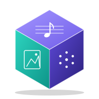

  

# Babel Gallery

An infinite gallery of every possible tune and every possible picture, inspired by Borges’ *Library of Babel*. The home page lets you choose between **Music** and **Images**.

Every piece has a unique address. The number encodes a complete piece: sound design, tempo, a drum pattern and a 32-step melody. Type any address and you get a piece. Edit a piece and you get its address. Nothing is stored on a server; the whole thing is one static HTML file.

## Features

- **Compose:** a piano-roll grid with 24 notes (two octaves) over 32 steps, plus a three-row drum grid (hat, snare, kick). Steps can be notes, rests or *holds* that lengthen the previous note.
- **Sound:** 16 starting presets and 14 synthesizer parameters (waveform, harmonics, attack, sustain, decay, release, filter, filter sweep, vibrato, chorus, octave, reverb, drum kit, tempo). Every combination is part of the location number.
- **Address:** paste or copy a short base-62 address (digits and letters), and choose the scale used by the “Musical” generator.
- **Random:** one button for a fresh piece with random sound settings; “Musical” and “Noise” generate in the Number tab.
- **Shareable:** the current location is kept in the URL hash, so a link opens the same piece.
- **Soft, raised-surface interface** (neumorphic style) with automatic light and dark themes.

## How it works

A location is mapped to a piece with a bijective scramble, so every number is one piece and every piece is one number.

1. The piece is a list of digits in a mixed radix: 14 sound parameters (each with its own base), 32 drum steps (base 8, one bit each for kick, snare and hat) and 32 melody steps (base 26: rest, 24 notes, or hold).
2. The product of all bases is the size of the library, about 1084 pieces. The sound parameters alone give roughly 3.8 × 109 combinations.
3. Addresses are written in base 62 (0–9, A–Z, a–z), about 45% shorter than decimal and still exact.
4. The raw digits are scrambled with `y = (a·x + c) mod M`, where `a` is coprime to `M`. This spreads neighbouring numbers across very different pieces and can be inverted exactly, which is how editing a piece gives back its number.

Instruments are synthesized live with the Web Audio API (oscillators, filters, FM, convolution reverb and noise-based drums). There are no audio samples, so the sounds are simpler than recordings of real instruments.

## Run locally

No build step and no dependencies. Open `index.html` in a browser and choose a section. In the music gallery, press **Play**. Browsers only start audio after a click or tap.

## Deploy with GitHub Pages

1. Make the repository public and keep the page as `index.html` in the root.
2. Go to **Settings → Pages**, choose **Deploy from a branch**, then `main` and `/ (root)`, and save.
3. After a minute or two the site is live at `https://USERNAME.github.io/REPO/`.

## Finds page setup

The Finds page needs no server. People submit a find as a GitHub issue, and the page shows only the issues you approve.

1. In the repository, make sure **Issues** are enabled (Settings → General → Features).
2. Create a label named `approved` (Issues → Labels → New label).
3. When someone submits a find, open the issue, check it, and add the `approved` label. It then appears on the Finds page.

The repository name is set at the top of the script in `finds.html` (`REPO`). Visitors need a free GitHub account to submit. Notes and titles are shown as plain text, and links open only to the gallery pages built from the validated address.

## Browser support

A current browser with `BigInt` and, for the music page, Web Audio.

## Files

| File | Purpose |
| --- | --- |
| `index.html` | Home page: choose Music or Images |
| `music.html` | Music gallery |
| `image.html` | Image gallery |
| `finds.html` | Community finds: browse approved posts and share new ones |
| `README.md` | This file |

Each page is a single self-contained file with no dependencies. Keep all file names lowercase, because GitHub Pages is case-sensitive.

## License

This project is released under the [MIT License](LICENSE).

Copyright (c) 2026 Mehrzad
